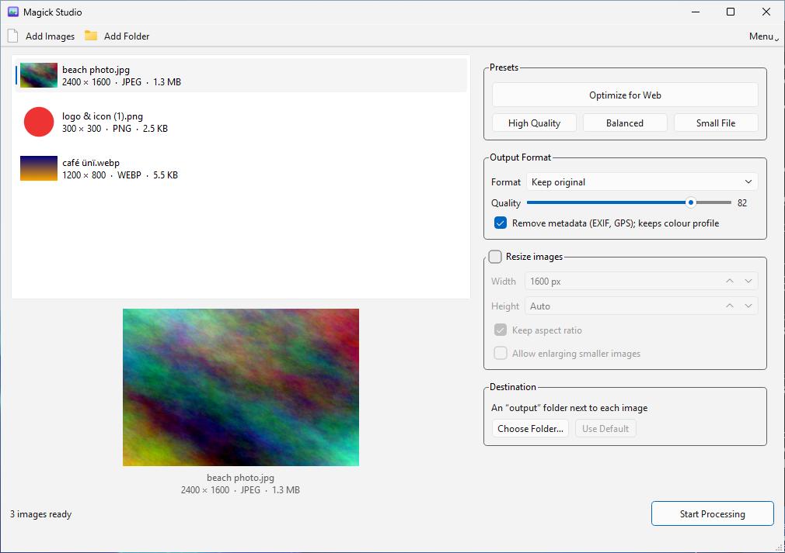
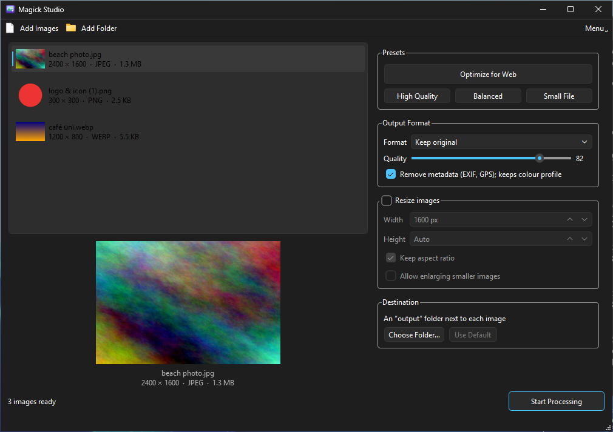

# Magick Studio

A simple desktop app for resizing, compressing, converting and optimizing images with
[ImageMagick](https://imagemagick.org), without typing long command lines.

- **Linux:** a native GNOME app (GTK 4 / Libadwaita). Install from source with `install.sh`.
- **Windows (new in v1.1.0):** a Qt (PySide6) app with ImageMagick built in. Install it
  with a normal setup program. No administrator rights or separate ImageMagick needed.

Both editions share the same image-processing engine and have the same features.

## Downloads

| Platform | Get it | Notes |
| --- | --- | --- |
| Windows x64 | [`MagickStudio-Setup-1.1.0-x64.exe`](https://github.com/yassermaina/magick-studio/releases/latest) from the latest release | Per-user installer, about 37 MB. See [Windows installation](#windows-installation). |
| Linux | Source code (`git clone` or the release's source archive) | Run `./install.sh`. See [Linux installation](#linux-installation). |

All versions are listed on the [Releases](https://github.com/yassermaina/magick-studio/releases) page.

## Screenshots

### Linux


*The GTK app on Fedora 44 (GNOME).*

### Windows





*The packaged Windows app, captured automatically on a GitHub-hosted Windows Server 2025
runner (the same Windows build as Windows 11 24H2). It follows the Windows light/dark
app setting.*

## Features

- **Import** with *Add Images*, *Add Folder* (including subfolders), drag and drop, or
  from the command line (`magick-studio photo.jpg ~/Pictures/trip` on Linux). Shows thumbnails, a preview, dimensions,
  format and file size. Damaged or unsupported files are flagged and skipped.
- **Resize** by width and/or height (0 = automatic). Keep the aspect ratio or force exact
  dimensions. Enlarging is off by default. Turn resizing off to keep original dimensions.
- **Compress** with a 1–100 quality slider (default 82) and *High Quality* (92),
  *Balanced* (82) and *Small File* (65) presets.
- **Convert** to JPEG, PNG or WebP, or keep the original format. **AVIF** is offered
  automatically when your ImageMagick build can write it.
- **Optimize for Web** in one click: WebP, max 1600 × 1600, quality 82, metadata removed,
  no upscaling, highest compression effort.
- **Batch processing** in the background with a progress bar and a *Cancel* button.
  A summary shows successes, failures and original → processed size with % saved.
- **Safe output**:
  - Results go to an `output` folder next to each image, or to a folder you choose.
  - Originals are never modified.
  - Existing files are never overwritten (`photo (1).webp`, `photo (2).webp`, …).
  - Failed or cancelled jobs leave no partial files behind.

Image handling details:

- EXIF orientation is applied *before* metadata is removed, so photos are never sideways.
- *Remove Metadata* strips EXIF (including GPS), XMP, IPTC and comments, and keeps the
  colour profile so colours stay correct.
- Transparency is kept for PNG, WebP and AVIF. JPEG output gets a white background.
- Supported inputs: JPEG, PNG, WebP, AVIF, GIF, BMP, TIFF, HEIC/HEIF and JPEG XL, as far
  as your ImageMagick can read them. Animated or multi-page files use the first frame.

Platform differences:

| | Linux | Windows |
| --- | --- | --- |
| Interface | GTK 4 / Libadwaita | Qt 6 (PySide6) |
| ImageMagick | From your distribution (6 or 7) | ImageMagick 7.1.2 built in |
| AVIF output | Depends on your distribution's ImageMagick | Included |
| Light/dark style | Follows GNOME | Follows the Windows app mode |
| Installation | Per user, from source (`install.sh`) | Per-user setup program |

## Linux installation

### Supported distributions

| Distribution | Status | Tested with |
| --- | --- | --- |
| Fedora 44 | ✅ Tested on a GNOME Wayland desktop and in a clean container | GTK 4.22, Libadwaita 1.9, ImageMagick 7.1.2 |
| Ubuntu 24.04 LTS | ✅ Tested in a clean container, GUI on Xvfb (X11) | GTK 4.14, Libadwaita 1.5, ImageMagick 6.9.12 |
| Debian 13 (trixie) | ✅ Tested in a clean container, GUI on Xvfb (X11) | GTK 4.18, Libadwaita 1.7, ImageMagick 7.1.1 |
| Debian 12 (bookworm) | ❌ Not supported | Ships Libadwaita 1.2; the installer stops with a clear message |

Other distributions with GTK ≥ 4.14, Libadwaita ≥ 1.5, PyGObject and ImageMagick 6 or 7
should work, but the installer only installs packages automatically on Fedora and
Debian/Ubuntu-based systems.

### Requirements

- Python 3.10 or newer
- GTK 4.14+ and Libadwaita 1.5+, with PyGObject bindings
- ImageMagick 7 (`magick`) or ImageMagick 6 (`convert` and `identify`)
- Optional: `cwebp` (package `webp` / `libwebp-tools`), needed on Ubuntu 24.04. See
  [Known limitations](#known-limitations).

### Installing

Download or clone the source, then run the installer **as your normal user** (not root):

```bash
git clone https://github.com/yassermaina/magick-studio.git
cd magick-studio
./install.sh
```

The installer detects your distribution and installs any missing system packages
(it asks first and uses `sudo`). It then installs Magick Studio **for your user only**:

| File | Location |
| --- | --- |
| Application | `~/.local/share/magick-studio/` |
| Command | `~/.local/bin/magick-studio` |
| App menu launcher | `~/.local/share/applications/io.github.magickstudio.MagickStudio.desktop` |
| Icon | `~/.local/share/icons/hicolor/scalable/apps/io.github.magickstudio.MagickStudio.svg` |

Options:

- `--yes`: install missing packages without asking.
- `--skip-deps`: don't check or install system packages.
- `--with-avif`: also try to install AVIF support (`ImageMagick-heic` on Fedora,
  `libheif-plugin-aomenc` on Debian/Ubuntu).

If `~/.local/bin` was not on your `PATH` yet, open a new terminal (or log out and back
in) before typing `magick-studio`. The app-menu launcher works right away.

#### Fedora

```bash
./install.sh
```

Packages installed when missing:
`python3 python3-gobject gtk4 libadwaita gobject-introspection ImageMagick` (plus
`libglvnd-gles` on minimal installs that lack OpenGL ES).

#### Ubuntu 24.04 or newer

```bash
./install.sh
```

Packages installed when missing:
`python3 python3-gi gir1.2-gtk-4.0 gir1.2-adw-1 imagemagick webp`.

#### Debian 13 or newer

```bash
./install.sh
```

Same packages as Ubuntu. Debian 12 is not supported (its Libadwaita is too old).

#### Manual dependency installation

```bash
# Fedora
sudo dnf install python3-gobject gtk4 libadwaita gobject-introspection ImageMagick
# Debian / Ubuntu
sudo apt install python3-gi gir1.2-gtk-4.0 gir1.2-adw-1 imagemagick webp
```

Then run `./install.sh --skip-deps`, or start the app directly from the source folder
with `python3 main.py`.

### Using Magick Studio on Linux

Open **Magick Studio** from the application menu, or run:

```bash
magick-studio                     # open the app
magick-studio ~/Pictures/trip     # open with a folder already loaded
```

1. Add images (buttons, a folder, or drag and drop).
2. Pick a preset, or adjust format, quality, metadata and resize settings.
3. Optionally choose an output folder (default: `output` next to each image).
4. Click **Start Processing**. You can cancel at any time.

| Shortcut | Action |
| --- | --- |
| Ctrl+O | Add images |
| Ctrl+Shift+O | Add folder |
| Ctrl+Enter | Start processing |
| Ctrl+Q | Quit |

Folder imports skip hidden folders, folders named `output`, and your chosen output
folder, so processed images are never imported again.

### Uninstalling on Linux

```bash
./uninstall.sh
```

This removes only the files listed in the installation table. Your images, `output`
folders and system packages (ImageMagick, GTK, …) are left untouched. A
`~/.local/bin/magick-studio` that was not created by the installer is never removed
or overwritten.

## Windows installation

### Requirements

- Windows 10 version 1809 or later, or Windows 11, **64-bit (x64)**
- About 150 MB of disk space
- Nothing else. ImageMagick and Python are included.

### Installing

1. Open the [latest release](https://github.com/yassermaina/magick-studio/releases/latest).
2. Under **Assets**, download `MagickStudio-Setup-1.1.0-x64.exe`.
3. *(Optional)* Check the download. In PowerShell, run
   `Get-FileHash .\MagickStudio-Setup-1.1.0-x64.exe` and compare the result with the
   SHA-256 in the release notes.
4. Double-click the installer. The installer is not code-signed, so Windows SmartScreen
   may show **"Windows protected your PC"**. Click **More info**, then **Run anyway**.
5. Accept the license and keep the default folder (`%LOCALAPPDATA%\Programs\Magick Studio`).
   Optionally tick **Create a desktop shortcut**. Administrator rights are not needed,
   and Magick Studio is installed for your user account only.
6. Click **Install**, then **Finish** to start Magick Studio.
7. Later, open **Magick Studio** from the Start menu.

To **update**, run the newer installer. It replaces the old version in place. 1.1.0 is the first
Windows release, so only re-installing the same version has been tested so far.

### Using Magick Studio on Windows

1. Click **Add Images** or **Add Folder**, or drag images or folders onto the window.
2. Pick a preset, or adjust format, quality, metadata and resize settings.
3. Optionally click **Choose Folder…** for the output (default: `output` next to each image).
4. Click **Start Processing**. When it finishes, the summary can open the output folder.

| Shortcut | Action |
| --- | --- |
| Ctrl+O | Add images |
| Ctrl+Shift+O | Add folder |
| Delete | Remove selected images from the list |
| Ctrl+Enter | Start processing |
| F1 | Show shortcuts |
| Ctrl+Q | Quit |

### Uninstalling on Windows

Open **Settings → Apps → Installed apps**, find **Magick Studio**, and choose
**Uninstall**. This removes the program folder, the shortcuts and the Apps entry.
Your images and `output` folders are never touched.

### What was tested on Windows

Every change is built and tested on GitHub-hosted **Windows Server 2025 x64** runners
(build 26100). Each run:

- runs the backend tests (52 passed; 5 Linux- or `cwebp`-specific tests skipped) and the
  Qt interface tests (10 passed) on real Windows, against the bundled ImageMagick
- checks the packaged app for all required files (Qt plugins, MSVC runtime, ImageMagick,
  licenses)
- converts real images with the packaged app, with Python and the runner's own
  ImageMagick removed from `PATH`
- opens the packaged app's window and loads images
- checks that no console windows flash while images are processed
- installs the app silently, checks the Start Menu shortcut and the per-user Apps entry,
  converts images with the installed app, re-installs over it, uninstalls it, and checks
  that the user's images were not touched

## Troubleshooting

**Windows: "Windows protected your PC" when running the installer.** The installer is
not code-signed. Click **More info**, then **Run anyway**. Check the SHA-256 first if
you want to be sure the file is genuine (step 3 above).

**Windows: "ImageMagick 7 (magick.exe) was not found".** The installation is
incomplete, for example because antivirus software quarantined `magick.exe`. Reinstall
Magick Studio, and if needed allow
`%LOCALAPPDATA%\Programs\Magick Studio\_internal\imagemagick\magick.exe` in your
antivirus.

**Windows: the installer refuses to run on Windows on ARM.** Only an x64 build is
provided, and the installer only allows x64 Windows. ARM64 devices are not supported.

**Linux: "ImageMagick not found".** Install ImageMagick (`sudo dnf install ImageMagick`
or `sudo apt install imagemagick`), or rerun `./install.sh`.

**Linux: `magick-studio: command not found`.** `~/.local/bin` is not on your `PATH` yet.
Open a new terminal or log out and back in, or start the app from the application menu.

**Linux: the app won't start on Debian 12 or Ubuntu 22.04.** These ship a Libadwaita that
is too old. See [Supported distributions](#supported-distributions).

**WebP quality has no effect (Ubuntu 24.04).** Install `cwebp` (`sudo apt install webp`).
See below.

**AVIF is missing from the format list.** Your ImageMagick can't write AVIF. On Fedora,
try `./install.sh --with-avif`. The Windows edition always includes AVIF.

**A processed image is larger than the original.** This happens with small or already
optimized images. The summary shows it as "% larger". Try a lower quality or a different
format.

## Known limitations

- **Ubuntu 24.04 WebP quality:** its ImageMagick (6.9.12-98) ignores the WebP quality
  setting. Magick Studio detects this and encodes WebP with `cwebp` instead, which the
  installer adds (`webp` package). Without `cwebp`, WebP files still work but the quality
  slider has no effect for WebP, and the app says so next to the slider.
- **AVIF** depends on your ImageMagick build. It was available out of the box on
  Ubuntu 24.04 and Debian 13, but not on Fedora 44 without `ImageMagick-heic`.
  `--with-avif` installs that package; AVIF encoding through it was not verified.
- **Animated GIF/WebP:** only the first frame is processed.
- **Very large images:** images over 200 megapixels are refused, to protect against
  crafted files that would use many gigabytes of memory.
- **File contents are checked:** files are accepted only if their content is one of the
  supported image formats, whatever their name. PostScript, PDF and SVG files renamed
  to `.jpg` (for example) are refused.
- **Small inputs can grow:** converting small or already optimized images can make
  them slightly *larger*. The app reports this as "% larger".
- **Debian 12:** not supported, because its Libadwaita (1.2) is older than 1.5 (verified).
  The installer installs the APT packages before it can check the Libadwaita version,
  then stops with a clear message. Ubuntu 22.04 ships Libadwaita 1.1 and is also
  unsupported (not tested).
- **Windows versions:** automated tests run on Windows Server 2025 x64 (Windows 11 24H2
  codebase). The app has **not** been tested on Windows 10 or on a Windows 11 desktop PC.
  It is expected to work on both (x64), but this is not verified yet.
- **Windows on ARM:** not supported. Only an x64 build is provided, and the installer
  refuses to run on ARM64 Windows.
- **Windows drag and drop:** implemented, but only covered by the automated tests through
  the same code path that *Add Images* uses, not by simulating a real mouse drag.
- **Windows long paths:** paths longer than 260 characters have not been tested.
- **Windows installer:** not code-signed (see [Troubleshooting](#troubleshooting)).
- **Windows size:** the installed app is about 136 MB, mostly Qt and ImageMagick.
- **Container GUI tests:** on Ubuntu and Debian the GUI was tested under Xvfb (X11) in
  containers, not on a full desktop session.

## Development

```text
image_processor.py   shared ImageMagick backend (no GUI dependency)
main.py              Linux interface (GTK 4 / Libadwaita)
install.sh           Linux per-user installer
uninstall.sh         Linux uninstaller
windows/             Windows interface (PySide6), build script, installer, CI checks
tests/               backend and GTK tests
assets/              icons (SVG for Linux, ICO for Windows)
docs/                screenshots and the Windows feasibility study
```

PySide6 is only used by the Windows edition. Linux users don't need it.
See [`windows/README.md`](windows/README.md) for building and testing the Windows edition.

All external programs run through `subprocess` with argument lists (never `shell=True`),
absolute paths and an explicit output coder. This makes spaces, Unicode, leading dashes,
colons and brackets in filenames safe.

See [CONTRIBUTING.md](CONTRIBUTING.md) for guidelines.

## Testing

```bash
sudo dnf install python3-pytest          # Fedora
sudo apt install python3-pytest xvfb     # Debian / Ubuntu

python3 -m pytest tests                  # on a desktop session
xvfb-run -a python3 -m pytest tests      # headless
```

The suite covers:

- resizing, conversion and compression
- the web preset, transparency and EXIF orientation
- filenames with spaces, Unicode, leading dashes, colons and brackets
- output collisions and output file permissions
- invalid images, missing ImageMagick, and unusable output folders
- original-file preservation
- cancellation and temporary-file cleanup
- the `cwebp` fallback
- two GUI tests: a real window processes a folder, and the "ImageMagick not found" state

GUI tests are skipped when no display is available. `cwebp` tests are skipped when
`cwebp` is not installed.

GitHub Actions runs two workflows:

- `.github/workflows/tests.yml` runs the Linux installer and tests on Ubuntu 24.04, plus
  the tests in Debian 13 and Fedora 44 containers.
- `.github/workflows/windows.yml` builds and tests the Windows edition on
  `windows-2025`. It uploads the installer, a portable build, test reports and
  screenshots as artifacts. See [What was tested on Windows](#what-was-tested-on-windows).

Windows tests (on Windows, after `windows\build.ps1 -Steps imagemagick`):

```powershell
$env:MAGICK_STUDIO_MAGICK = "$PWD\build\windows\imagemagick\magick.exe"
python -m pytest tests windows\tests
```

## Releases

| Version | Platforms |
| --- | --- |
| [v1.1.0](https://github.com/yassermaina/magick-studio/releases/tag/v1.1.0) | Linux and Windows (x64 installer) |
| [v1.0.0](https://github.com/yassermaina/magick-studio/releases/tag/v1.0.0) | Linux |

See [CHANGELOG.md](CHANGELOG.md) for details.

## License

MIT. See [LICENSE](LICENSE). The Windows edition includes third-party software
(ImageMagick, Qt/PySide6, Python) under their own licenses. See
[`windows/THIRD-PARTY-NOTICES.txt`](windows/THIRD-PARTY-NOTICES.txt).
