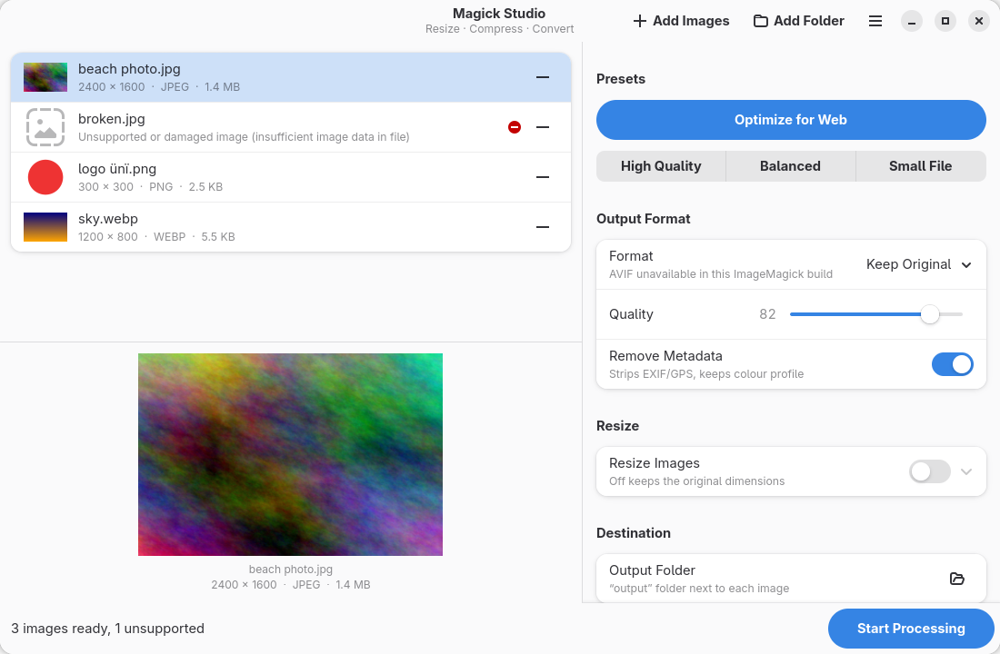
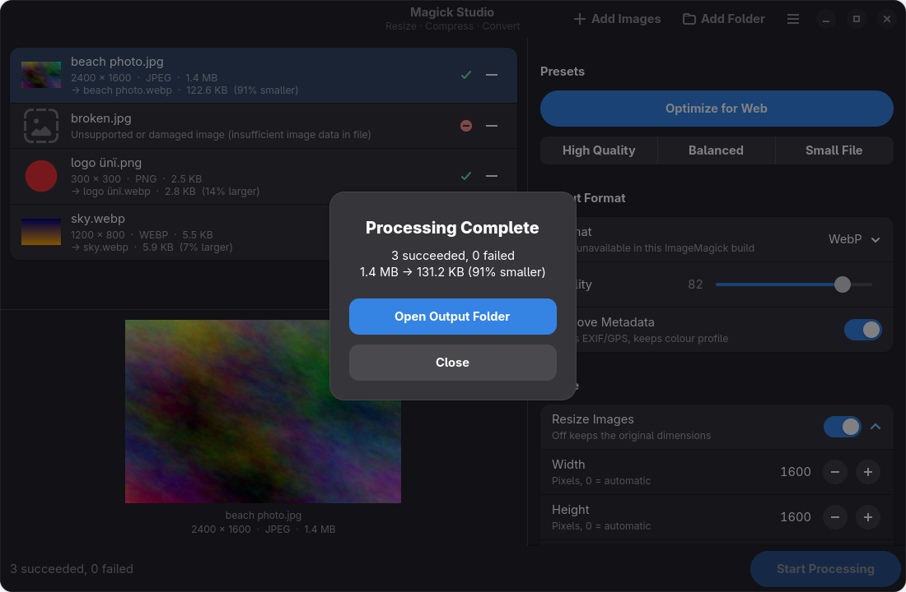

# Magick Studio

A simple, native GNOME app for resizing, compressing, converting and optimizing
images with [ImageMagick](https://imagemagick.org), without typing long command lines.

Built with Python 3, GTK 4, Libadwaita and PyGObject. Follows the system light/dark style.

> **Magick Studio v1.0.0 is the first stable release, for Linux.** Windows support is
> under investigation and planned for a future version. See [Windows roadmap](#windows-roadmap).





*Screenshots of the real application on Fedora 44.*

## Features

- **Import** with *Add Images*, *Add Folder* (including subfolders), drag and drop, or
  `magick-studio photo.jpg ~/Pictures/trip`. Shows thumbnails, a preview, dimensions,
  format and file size. Damaged or unsupported files are flagged and skipped.
- **Resize** by width and/or height (0 = automatic). Keep the aspect ratio or force exact
  dimensions. Enlarging is off by default. Turn resizing off to keep original dimensions.
- **Compress** with a 1–100 quality slider (default 82) and *High Quality* (92),
  *Balanced* (82) and *Small File* (65) presets.
- **Convert** to JPEG, PNG or WebP, or keep the original format. **AVIF** is offered
  automatically when your ImageMagick build can write it.
- **Optimize for Web** in one click: WebP, max 1600 × 1600, quality 82, metadata removed,
  no upscaling, highest compression effort.
- **Batch processing** in the background with a progress bar and a *Cancel* button.
  A summary shows successes, failures and original → processed size with % saved.
- **Safe output**:
  - Results go to an `output` folder next to each image, or to a folder you choose.
  - Originals are never modified.
  - Existing files are never overwritten (`photo (1).webp`, `photo (2).webp`, …).
  - Failed or cancelled jobs leave no partial files behind.

Image handling details:

- EXIF orientation is applied *before* metadata is removed, so photos are never sideways.
- *Remove Metadata* strips EXIF (including GPS), XMP, IPTC and comments, and keeps the
  colour profile so colours stay correct.
- Transparency is kept for PNG, WebP and AVIF. JPEG output gets a white background.
- Supported inputs: JPEG, PNG, WebP, AVIF, GIF, BMP, TIFF, HEIC/HEIF and JPEG XL, as far
  as your ImageMagick can read them. Animated or multi-page files use the first frame.

## Supported distributions

| Distribution | Status | Tested with |
| --- | --- | --- |
| Fedora 44 | ✅ Tested on a GNOME Wayland desktop and in a clean container | GTK 4.22, Libadwaita 1.9, ImageMagick 7.1.2 |
| Ubuntu 24.04 LTS | ✅ Tested in a clean container, GUI on Xvfb (X11) | GTK 4.14, Libadwaita 1.5, ImageMagick 6.9.12 |
| Debian 13 (trixie) | ✅ Tested in a clean container, GUI on Xvfb (X11) | GTK 4.18, Libadwaita 1.7, ImageMagick 7.1.1 |
| Debian 12 (bookworm) | ❌ Not supported | Ships Libadwaita 1.2; the installer stops with a clear message |

Other distributions with GTK ≥ 4.14, Libadwaita ≥ 1.5, PyGObject and ImageMagick 6 or 7
should work, but the installer only installs packages automatically on Fedora and
Debian/Ubuntu-based systems.

## Requirements

- Python 3.10 or newer
- GTK 4.14+ and Libadwaita 1.5+, with PyGObject bindings
- ImageMagick 7 (`magick`) or ImageMagick 6 (`convert` and `identify`)
- Optional: `cwebp` (package `webp` / `libwebp-tools`), needed on Ubuntu 24.04. See
  [Known limitations](#known-limitations).

## Installation

Download or clone the source, then run the installer **as your normal user** (not root):

```bash
cd magick-studio
./install.sh
```

The installer detects your distribution and installs any missing system packages
(it asks first and uses `sudo`). It then installs Magick Studio **for your user only**:

| File | Location |
| --- | --- |
| Application | `~/.local/share/magick-studio/` |
| Command | `~/.local/bin/magick-studio` |
| App menu launcher | `~/.local/share/applications/io.github.magickstudio.MagickStudio.desktop` |
| Icon | `~/.local/share/icons/hicolor/scalable/apps/io.github.magickstudio.MagickStudio.svg` |

Options:

- `--yes`: install missing packages without asking.
- `--skip-deps`: don't check or install system packages.
- `--with-avif`: also try to install AVIF support (`ImageMagick-heic` on Fedora,
  `libheif-plugin-aomenc` on Debian/Ubuntu).

If `~/.local/bin` was not on your `PATH` yet, open a new terminal (or log out and back
in) before typing `magick-studio`. The app-menu launcher works right away.

### Fedora

```bash
./install.sh
```

Packages installed when missing:
`python3 python3-gobject gtk4 libadwaita gobject-introspection ImageMagick` (plus
`libglvnd-gles` on minimal installs that lack OpenGL ES).

### Ubuntu 24.04 or newer

```bash
./install.sh
```

Packages installed when missing:
`python3 python3-gi gir1.2-gtk-4.0 gir1.2-adw-1 imagemagick webp`.

### Debian 13 or newer

```bash
./install.sh
```

Same packages as Ubuntu. Debian 12 is not supported (its Libadwaita is too old).

### Manual dependency installation

```bash
# Fedora
sudo dnf install python3-gobject gtk4 libadwaita gobject-introspection ImageMagick
# Debian / Ubuntu
sudo apt install python3-gi gir1.2-gtk-4.0 gir1.2-adw-1 imagemagick webp
```

Then run `./install.sh --skip-deps`, or start the app directly from the source folder
with `python3 main.py`.

## Usage

Open **Magick Studio** from the application menu, or run:

```bash
magick-studio                     # open the app
magick-studio ~/Pictures/trip     # open with a folder already loaded
```

1. Add images (buttons, a folder, or drag and drop).
2. Pick a preset, or adjust format, quality, metadata and resize settings.
3. Optionally choose an output folder (default: `output` next to each image).
4. Click **Start Processing**. You can cancel at any time.

| Shortcut | Action |
| --- | --- |
| Ctrl+O | Add images |
| Ctrl+Shift+O | Add folder |
| Ctrl+Enter | Start processing |
| Ctrl+Q | Quit |

Folder imports skip hidden folders, folders named `output`, and your chosen output
folder, so processed images are never imported again.

## Uninstallation

```bash
./uninstall.sh
```

This removes only the files listed in the installation table. Your images, `output`
folders and system packages (ImageMagick, GTK, …) are left untouched. A
`~/.local/bin/magick-studio` that was not created by the installer is never removed
or overwritten.

## Known limitations

- **Ubuntu 24.04 WebP quality:** its ImageMagick (6.9.12-98) ignores the WebP quality
  setting. Magick Studio detects this and encodes WebP with `cwebp` instead, which the
  installer adds (`webp` package). Without `cwebp`, WebP files still work but the quality
  slider has no effect for WebP, and the app says so next to the slider.
- **AVIF** depends on your ImageMagick build. It was available out of the box on
  Ubuntu 24.04 and Debian 13, but not on Fedora 44 without `ImageMagick-heic`.
  `--with-avif` installs that package; AVIF encoding through it was not verified.
- **Animated GIF/WebP:** only the first frame is processed.
- **Small inputs can grow:** converting small or already optimized images can make
  them slightly *larger*. The app reports this as "% larger".
- **Debian 12:** not supported, because its Libadwaita (1.2) is older than 1.5 (verified).
  The installer installs the APT packages before it can check the Libadwaita version,
  then stops with a clear message. Ubuntu 22.04 ships Libadwaita 1.1 and is also
  unsupported (not tested).
- **Container GUI tests:** on Ubuntu and Debian the GUI was tested under Xvfb (X11) in
  containers, not on a full desktop session.

## Development

```text
main.py              GTK 4 / Libadwaita user interface
image_processor.py   ImageMagick backend (no GTK dependency)
tests/               pytest suite
assets/icon.svg      application icon
install.sh           per-user installer
uninstall.sh         uninstaller
docs/screenshots/    README screenshots
experimental/windows/  Windows proof of concept (not installed, not supported)
```

All external programs run through `subprocess` with argument lists (never `shell=True`),
absolute paths and an explicit output coder. This makes spaces, Unicode, leading dashes,
colons and brackets in filenames safe.

See [CONTRIBUTING.md](CONTRIBUTING.md) for guidelines.

## Testing

```bash
sudo dnf install python3-pytest          # Fedora
sudo apt install python3-pytest xvfb     # Debian / Ubuntu

python3 -m pytest tests                  # on a desktop session
xvfb-run -a python3 -m pytest tests      # headless
```

The suite covers:

- resizing, conversion and compression
- the web preset, transparency and EXIF orientation
- filenames with spaces, Unicode, leading dashes, colons and brackets
- output collisions and output file permissions
- invalid images, missing ImageMagick, and unusable output folders
- original-file preservation
- cancellation and temporary-file cleanup
- the `cwebp` fallback
- two GUI tests: a real window processes a folder, and the "ImageMagick not found" state

GUI tests are skipped when no display is available. `cwebp` tests are skipped when
`cwebp` is not installed.

A GitHub Actions workflow (`.github/workflows/tests.yml`) runs the installer and tests
on Ubuntu 24.04, plus the tests in Debian 13 and Fedora 44 containers.

## Windows roadmap

Windows is **not supported in v1.0.0**. A feasibility study and a PySide6 proof of
concept live in [`experimental/windows/`](experimental/windows/README.md). They have
been tested **on Fedora only, never on Windows**, and are not installed by `install.sh`.

Planned approach (not implemented yet):

1. **Shared backend.** Keep `image_processor.py` for both platforms and apply the
   prepared Windows changes: no console windows, Windows-only `magick.exe` detection,
   and a bundled-ImageMagick path.
2. **PySide6 interface for Windows.** Bring the proof of concept to feature parity. GTK 4
   and Libadwaita remain the Linux interface.
3. **ImageMagick integration.** Bundle `magick.exe` from the official portable Windows build.
4. **Windows tests.** Add tests for drive letters, Unicode and UNC paths, long paths,
   console-window suppression and cancellation, run on a Windows CI runner.
5. **Packaging.** PyInstaller `--onedir --windowed` build with a `.ico` icon.
6. **Installer.** Inno Setup per-user installer with a Start Menu entry and a safe uninstaller.
7. **Verification.** Manual testing on Windows 10 and Windows 11 (x64, then ARM64).
8. **Release.** A Windows release, only after the steps above pass.

## License

MIT. See [LICENSE](LICENSE).
